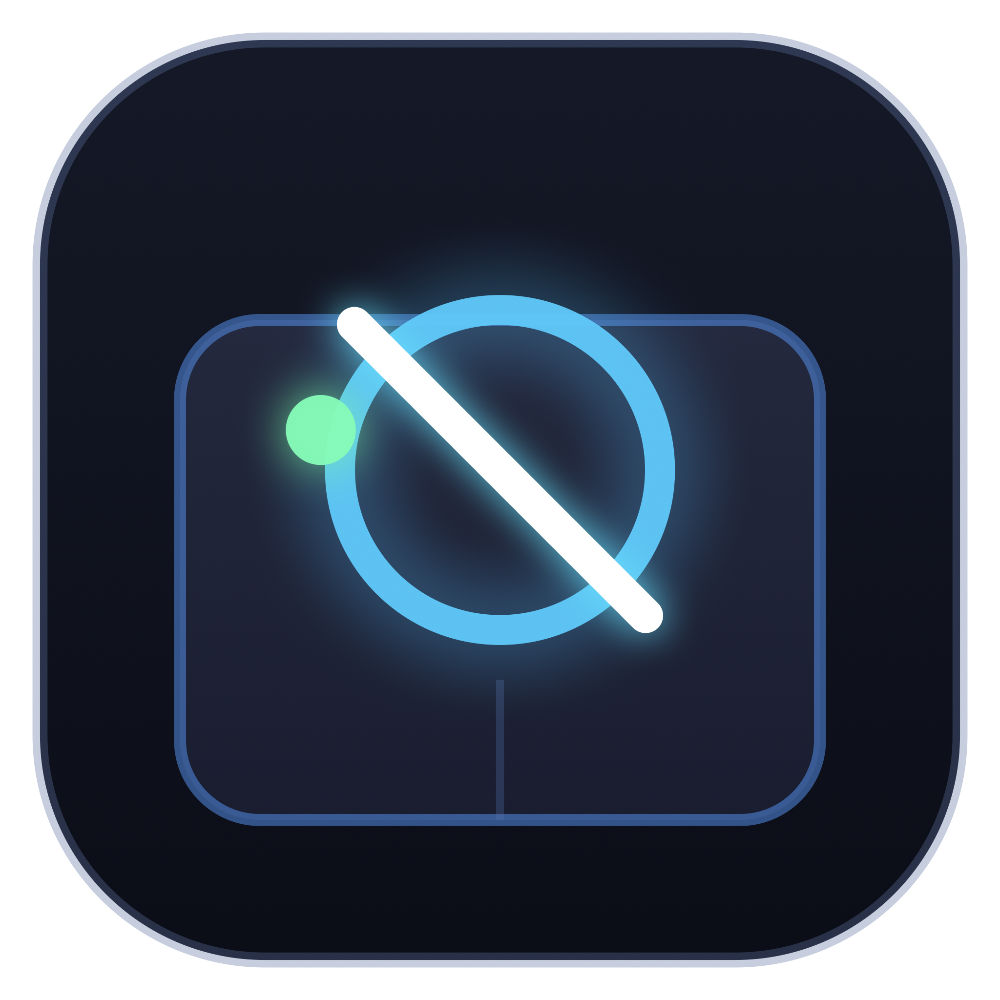

<p align="center">
  
  <h1 align="center">Trackpad Toggle</h1>
  <p align="center">
    A lightweight native macOS menu-bar utility that lets you disable and re-enable your MacBook's built-in trackpad using a configurable global keyboard shortcut.
  </p>
</p>

<p align="center">
  <a href="https://github.com/rajanraj2/trackpad-toggle/releases/latest"></a>
  <a href="https://github.com/rajanraj2/homebrew-tap"></a>
  <a href="https://github.com/rajanraj2/trackpad-toggle/releases/latest/download/TrackpadToggle.dmg"></a>
</p>

---

## 📥 Quick Download & Install

1. Download **[TrackpadToggle.dmg](https://github.com/rajanraj2/trackpad-toggle/releases/latest/download/TrackpadToggle.dmg)**.
2. Double-click the `.dmg` in Finder and drag **Trackpad Toggle** into **Applications**.
3. Launch via Spotlight (**⌘ + Space**) or Applications.
4. Check **Launch at Login** in the menu bar to start automatically on every boot.

---

- macOS 14 (Sonoma) or later (tested on macOS 27.0.1)
- MacBook with built-in trackpad (Apple Silicon confirmed)
- Xcode Command Line Tools (`xcode-select --install`)

## Installation Options

### Option 1: Install via Homebrew (Fastest for Terminal / Developers)

Install Trackpad Toggle as a native Homebrew Cask:

```bash
brew install --cask rajanraj2/tap/trackpad-toggle
```

> **First Launch / Gatekeeper Note**:  
> Because this is a free, open-source application built without a paid Apple Developer ID certificate ($99/year), macOS may show an alert on first open: *“Apple could not verify TrackpadToggle is free of malware…”*  
> To allow it to run (only needed once):  
> - **Terminal (Instant)**: Run `xattr -d -r com.apple.quarantine /Applications/TrackpadToggle.app`  
> - **System Settings**: Go to **System Settings → Privacy & Security**, scroll down to Security, and click **Open Anyway**.  
> - **Finder**: Right-click `/Applications/TrackpadToggle.app` → select **Open** → click **Open**.  

To update in the future:
```bash
brew upgrade --cask trackpad-toggle
```

To cleanly uninstall:
```bash
brew uninstall --cask trackpad-toggle
```
### Option 2: macOS Disk Image (.dmg) — No Terminal Required

The easiest way to install Trackpad Toggle on any Mac without terminal:

1. Download **`TrackpadToggle.dmg`** from the [Releases](https://github.com/rajanraj2/trackpad-toggle/releases) page.
2. Double-click the `.dmg` file in Finder to open it.
3. Drag **`TrackpadToggle.app`** into the **Applications** folder shortcut.
4. Eject the disk image.
5. Open **Trackpad Toggle** from **Applications** or Spotlight (**⌘ + Space**).

> **Gatekeeper Note (First Launch)**: Since this is an open-source, ad-hoc signed app, macOS may display a standard security notice on first open. Simply **right-click (Control-click) `TrackpadToggle.app` → select Open → click Open** (or go to *System Settings → Privacy & Security → Open Anyway*). You only need to do this once.

### Option 3: Finder Double-Click Installer (`Install.command`)

If you cloned this repository locally:
1. In Finder, double-click **`Install.command`**.
2. It compiles the app, copies it to `/Applications`, and starts it in your menu bar automatically.

### Option 4: Automatic Startup at Login

Once launched:
1. Click the menu-bar icon → check **Launch at Login** (or toggle it in Settings).
2. **Zero clicks needed going forward**: The app automatically starts in the background every time you boot or log in to your Mac.

### Option 5: Build the DMG Locally

To generate the `.dmg` installer yourself:
```bash
bash build.sh --dmg
# Or run the dedicated packaging script:
./scripts/create_dmg.sh
```
This outputs **`build/TrackpadToggle.dmg`** (verified, compressed, with `/Applications` symlink).

macOS requires two TCC permissions before the event tap can suppress trackpad input.

| Permission | Where | Why |
|---|---|---|
| **Accessibility** | System Settings → Privacy & Security → Accessibility | Install a system-wide CGEventTap |
| **Input Monitoring** | System Settings → Privacy & Security → Input Monitoring | Allow the tap to *suppress* (not just observe) events |

Without both, the app runs but cannot block trackpad events. A warning banner appears in the menu.

**Steps after first launch:**

1. macOS shows the Accessibility prompt → click *Open System Settings* → toggle the switch.
2. Try toggling the trackpad — if a second alert appears mentioning Input Monitoring, open that panel too and enable the app.
3. Quit and relaunch. Both permissions persist across restarts.

## Usage

| Action | How |
|---|---|
| Toggle trackpad on/off | Press **⌃⌥⌘T** (default) or click the menu-bar icon |
| Toggle Block Cursor & Gestures | Click menu bar → **Block Cursor & Gestures** (checkmark) or in **Settings…** |
| Change shortcut key | Click menu bar → **Change Shortcut…** or open **Settings…** |
| Enable/disable startup at login | Click menu bar → **Launch at Login** (checkmark toggle) or in **Settings…** |
| Open Settings | Click menu bar → Settings… or press **⌘,** |
| Quit | Click menu bar → Quit, or press **⌘Q** in Settings |

### Configurable Trackpad Suppression (Block Cursor & Gestures)

You can configure the exact level of trackpad suppression to suit your workflow:

- **Full Lockdown (Default & Recommended)**:
  - **Cursor movement is completely frozen** (cursor does NOT move).
  - **All multi-touch gestures are blocked** (swipes, pinch-to-zoom, rotate, smart magnify).
  - **Clicks and scrolls are blocked** (physical click, tap-to-click, two-finger scroll).
  - Input from the trackpad is 100% disabled.

- **Partial Mode**:
  - Clicks, taps, and scrolling are suppressed, but cursor movement remains active.

**How to toggle this setting**:
- **From Menu Bar**: Click the menu-bar icon → toggle **Block Cursor & Gestures** (shows `✓` when enabled).
- **From Settings**: Open Settings → under **Trackpad Suppression Mode**, toggle **Block Cursor Movement & Gestures**.
### Setting & Updating Shortcut Key

You can customize the global toggle shortcut at any time:

1. Click the menu-bar icon and select **Change Shortcut…** (or open **Settings…**).
2. Click **Change Shortcut…** to enter recording mode.
3. Press your desired key combination with modifiers (e.g. `⌃⌥T`, `⌥⌘T`, `⌃⌘T`, or `F6`).
4. Press **Esc** to cancel without making changes.
5. Alternatively, click any of the **Quick Presets** (`⌃⌥⌘T`, `⌃⌥T`, `⌥⌘T`, `⌃⌘T`, `F6`) for 1-click switching.
6. If another app conflicts with your shortcut, the app warns you inline with an error badge.

The shortcut uses **Carbon `RegisterEventHotKey`**, so it works globally regardless of focused window, requires no Accessibility permission, and continues to fire when the trackpad is disabled.

### Automatic Startup at Login

You can have Trackpad Toggle start automatically when you log in:

- **From the Menu Bar**: Click the menu-bar icon → toggle **Launch at Login** (shows a checkmark `✓` when enabled).
- **From Settings**: Toggle **Start automatically at login**.

This uses the modern macOS `SMAppService.mainApp` Login Items API with a standard `~/Library/LaunchAgents` fallback, ensuring it starts seamlessly as a background menu-bar accessory.

### In-App Update Notifications & 1-Click Upgrade

Trackpad Toggle checks for updates automatically via the GitHub Releases API:

- **Menu Bar Notification**: When a new version is released on GitHub, a prominent menu item appears:  
  `⭐️ Update Available: vX.Y.Z (Click to Upgrade)`
- **1-Click Automatic In-Place Upgrade**:
  Clicking the update item presents an interactive prompt. Selecting **Download & Install Now** automatically:
  1. Downloads the latest `.dmg` release.
  2. Replaces `/Applications/TrackpadToggle.app` in place.
  3. Strips Gatekeeper quarantine attributes so it opens seamlessly.
  4. Automatically relaunches the updated version into the menu bar.
- **Manual Check**: You can also click **Check for Updates…** in the menu bar at any time to verify your version.

## Running Automated Tests

```bash
swift Tests/TrackpadToggleTests.swift
```

No permissions or hardware required. Tests cover state transitions, permission-failure paths, shortcut updates, presets, startup/login persistence, and update version comparisons. Expected output ends with `PASS` (28/28 tests passing).
## Architecture

```
Sources/
├── main.swift                     — NSApplication bootstrap
├── AppDelegate.swift              — coordinator, sleep/wake, permission alerts, menu actions
├── TrackpadState.swift            — explicit state enum (enabled/disabled/transitioning/…)
├── TrackpadController.swift       — protocol + CGEventTapController implementation
├── HotKeyManager.swift            — Carbon RegisterEventHotKey engine + conflict detection
├── LaunchAtLoginManager.swift     — SMAppService & LaunchAgent startup management
├── UpdateManager.swift            — GitHub Releases API update checker & in-place DMG updater
├── PermissionsManager.swift       — Accessibility + Input Monitoring TCC checks
├── Preferences.swift              — UserDefaults wrapper, shortcut presets & persistence
├── MenuBarController.swift        — NSStatusItem + dynamic NSMenu with quick toggles
└── SettingsWindowController.swift — SwiftUI settings, shortcut recorder & startup controls
```

## Trackpad Control Mechanism

### What was investigated

| Mechanism | Outcome |
|---|---|
| `IOHIDManager` seize (`kIOHIDOptionsTypeSeizeDevice`) | `kIOReturnNotPrivileged` — requires root. Eliminated. |
| `MultitouchSupport.framework` `MTDeviceStop` | Per-process stream only; WindowServer unaffected. Eliminated. |
| `defaults write com.apple.AppleMultitouchTrackpad USBMouseStopsTrackpad 1` | Only works when a USB mouse is present; needs re-login. Not suitable. |
| **CGEventTap** (`kCGHIDEventTap`, `kCGHeadInsertEventTap`, `kCGEventTapOptionDefault`) | ✅ **Selected.** Intercepts synthesised HID pointer events before delivery to any app. Requires Accessibility + Input Monitoring. |

### What CGEventTap suppresses

| Input | Suppressed? |
|---|---|
| Pointer movement | ✅ Yes |
| Physical click (left/right) | ✅ Yes |
| Tap-to-click | ✅ Yes (synthesised as a left-click at HID layer) |
| Two-finger scroll | ✅ Yes |
| Click-and-drag | ✅ Yes |
| System multitouch gestures (Mission Control, Launchpad swipe, Exposé) | ⚠️ **No** — these are processed inside WindowServer from raw MultitouchSupport data *before* CGEventTap sees them |

### Device discrimination

CGEventTap does not expose a stable per-device hardware identifier in a public API.  
Two heuristics are used to pass external-mouse events through:

- **Scroll events** — `kCGScrollWheelEventIsContinuous == 0` → discrete scroll wheel (external mouse) → passed through.
- **Pointer events** — `kCGMouseEventSubtype == 0` **and** `kCGMouseEventPressure == 0` → likely external mouse → passed through.

External USB/Bluetooth mice should continue to function normally for clicks and scrolling. Pointer movement from external mice is *best-effort* — the heuristic is reliable on tested hardware but not guaranteed across all third-party devices.

### Shortcut engine

The global shortcut uses **Carbon `RegisterEventHotKey`**, which operates at kernel level and requires **no TCC permissions**. This is the critical safety design: the recovery shortcut fires even if all TCC permissions are revoked and the trackpad is disabled.

## Recovery

If the trackpad is disabled and you cannot interact with the UI:

1. **Press the registered shortcut** (default **⌃⌥⌘T**) to toggle it back on.
2. **Quit the app** — the event tap is removed on exit, re-enabling the trackpad:
   - Via keyboard shortcut registered in Settings, or
   - Open Terminal and run: `killall TrackpadToggle`
3. **Reboot** — the trackpad always returns after a restart.

The app **never** affects the keyboard or external pointing devices independently.

## Manual Verification Checklist

Run these after building and launching the app:

- [ ] Menu bar icon appears (hand icon).
- [ ] Default state shows "Trackpad: Enabled".
- [ ] ⌃⌥⌘T disables — cursor stops responding to trackpad.
- [ ] Tap-to-click does not fire while disabled.
- [ ] Two-finger scroll does not fire while disabled.
- [ ] Keyboard input works normally while disabled.
- [ ] ⌃⌥⌘T re-enables — trackpad works immediately.
- [ ] Sleep → wake → state preserved correctly.
- [ ] Quitting the app always re-enables the trackpad.
- [ ] Settings → shortcut recorder → new combo takes effect without relaunch.
- [ ] Revoking Accessibility → permission warning appears in menu.

## Automated Releases & SemVer

Releases are fully automated via GitHub Actions using Pull Request labels:

| Label | Release Type | Example Bump |
|---|---|---|
| `release:patch` or `patch` | Bug fixes, small tweaks | `v1.0.0` → `v1.0.1` |
| `release:minor` or `minor` | New features, enhancements | `v1.0.0` → `v1.1.0` |
| `release:major` or `major` | Breaking changes | `v1.0.0` → `v2.0.0` |
| *(none)* | Docs, chore, internal refactoring | No release created |

### Release Flow
1. Add one of the labels (`release:patch`, `release:minor`, or `release:major`) to your Pull Request.
2. Once CI passes, click **Merge pull request**.
3. GitHub Actions automatically calculates the next version, pushes the tag (`vX.Y.Z`), creates the GitHub Release with `TrackpadToggle.dmg`, and updates `Casks/trackpad-toggle.rb` in [rajanraj2/homebrew-tap](https://github.com/rajanraj2/homebrew-tap).

## Limitations

1. **System gestures not blocked** — Mission Control, Exposé, Launchpad swipes bypass CGEventTap.
2. **No sandbox** — `CGEventTap` in suppression mode is incompatible with the App Sandbox entitlement. The app must run unsandboxed (standard for local developer tools).
3. **No notarisation** — the build script uses an ad-hoc signature. Gatekeeper will warn on first open; right-click → Open to bypass.
4. **External mouse discrimination is heuristic** — tested on Apple-standard hardware; exotic mice may behave differently.

## Troubleshooting

**App doesn't appear in the menu bar**  
Check that `LSUIElement = true` is in Info.plist and the binary is inside a valid `.app` bundle structure.

**Permission Loop: Prompts for Accessibility even though it's already enabled in System Settings**  
When the app is updated, rebuilt, or installed via Homebrew, macOS's security daemon (TCC) detects a new binary signature hash (`cdhash`). System Settings still shows the switch as "ON" from the older version, but macOS rejects the new binary under the hood.

To fix it:
- **In-App (1-Click)**: In the permission alert or in Settings, click **Reset Permission Cache (Fix Stale Hash)**.
- **Terminal**: Run:
  ```bash
  tccutil reset Accessibility com.powertools.trackpadtoggle
  tccutil reset ListenEvent com.powertools.trackpadtoggle
  ```
- **System Settings**: Go to **System Settings → Privacy & Security → Accessibility**, select **Trackpad Toggle**, click the **minus button (`-`)** to remove it, then re-add `/Applications/TrackpadToggle.app`. Do the same under **Input Monitoring**.

**Trackpad still moves cursor after disabling**  
Accessibility or Input Monitoring permission is missing. Open Settings → check the Permissions section.
**Shortcut doesn't fire**  
Another app has registered the same combination (Carbon hot keys are system-exclusive). Change the shortcut in Settings.

**App crashes on launch**  
Run from Terminal: `./build/TrackpadToggle.app/Contents/MacOS/TrackpadToggle` to see the error output.
